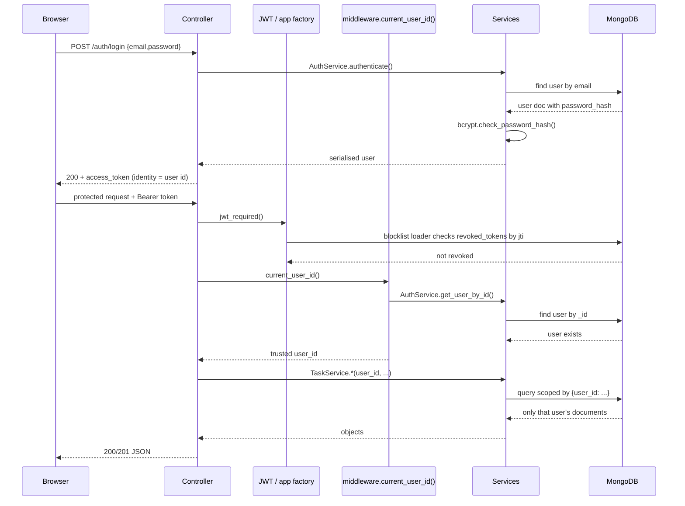
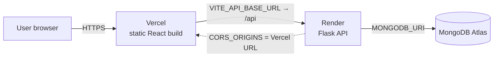

# TaskFlow architecture

This document describes how the TaskFlow frontend, API, and database fit together, why the layers are shaped the way they are, and how the code is verified.

## 1. System overview

TaskFlow is a two-process application plus a database:

- A React 18 single-page app built with Vite 5 and Tailwind CSS 3, served on port 5173 in development.
- A Flask 3 REST API served on port 5000 under the `/api` prefix.
- MongoDB 9 locally (`mongodb://127.0.0.1:27017`) or MongoDB Atlas in a hosted setup.

The browser only talks JSON to the API. There is no direct database access from the frontend.

```mermaid
flowchart TD
    U[User browser] -->|HTTP/JSON + Bearer JWT| FE[React SPA<br/>Vite + Tailwind<br/>port 5173]
    FE -->|Axios client with token interceptor| API[Flask app factory<br/>CORS · JWT · bcrypt · error handlers]
    API --> R[routes/<br/>URL → controller mapping]
    R --> C[controllers/<br/>jwt_required · validation · response shaping]
    C --> M[middleware/<br/>current_user_id()]
    M --> S[services/<br/>auth_service · task_service]
    S --> D[(MongoDB<br/>users · tasks · revoked_tokens)]
    CFG[config.py<br/>environment variables] -.-> API
    UTL[utils/<br/>errors · responses · serializers] -.-> API
    UTL -.-> S
```

## 2. Layer responsibilities

| Layer | Location | Responsibility |
| --- | --- | --- |
| Configuration | `backend/config.py` | Reads env vars once; development/production/testing classes; secret validation |
| App factory | `backend/app/__init__.py` | Creates the Flask app, configures CORS/JWT/bcrypt, registers blueprints, error handlers, JWT blocklist loader, and `/api/health` |
| Data access | `backend/app/db.py` | MongoClient creation, request-scoped DB handle, collection names, index creation |
| Routes | `backend/app/routes/` | Maps URLs and HTTP methods to controller functions only |
| Controllers | `backend/app/controllers/` | `jwt_required()`, JSON/query parsing, validation calls, `current_user_id()`, service calls, response shaping |
| Middleware | `backend/app/middleware/` | `current_user_id()` verifies the token's account still exists and returns the trusted identity |
| Services | `backend/app/services/` | Business rules, password hashing, token revocation, all collection queries with `user_id` scoping, dashboard aggregation |
| Validation | `backend/app/models/schemas.py` | Explicit payload/query validators with predictable messages |
| Utilities | `backend/app/utils/` | `errors.py` (central handlers), `responses.py` (JSON shapes), `serializers.py` (safe objects) |
| Frontend API client | `frontend/src/services/api.js` | Axios instance, bearer-token request interceptor, 401 cleanup, error message helpers |
| Frontend UI | `frontend/src/{pages,components,layouts,context,hooks}/` | Routing, presentation, auth/theme/toast state, reusable components |

The strict direction is **routes → controllers → middleware → services → collections**. Services never parse HTTP requests; controllers never build database queries.

## 3. Request lifecycle

Using `GET /api/tasks?q=report&page=2` as an example:

1. The React app issues a request through the shared Axios client. The request interceptor reads `taskflow.token` from localStorage and sets `Authorization: Bearer <token>`.
2. Flask matches the blueprint prefix `/api/tasks` and the route for `GET ""`, then calls `tasks_controller.list_tasks`.
3. `@jwt_required()` verifies the token signature, expiry, and revocation state. The blocklist loader registered in the app factory asks `AuthService.is_token_revoked(jti)` about `revoked_tokens`.
4. `validate_task_query(request.args)` checks `q`, enums, sort fields, order, page, and limit; invalid input raises `ValidationError` → `422`.
5. `current_user_id()` reads the token identity, confirms the account exists through `AuthService.get_user_by_id`, and returns the trusted user ID.
6. `TaskService.list_tasks` builds a query starting with `{"user_id": ObjectId(user_id)}`, adds the title regex, counts documents, applies sort/skip/limit, and serialises each task.
7. `app.utils.responses.success` returns `{"success": true, "data": {"tasks": [...]}, "meta": {...}}` with HTTP 200.
8. Errors at any stage are converted by `register_error_handlers` in `app/utils/errors.py` into the standard error envelope.

## 4. Authentication and authorization flow



Authentication has four complementary parts:

1. **`jwt_required()`** on every protected controller — verifies signature, expiry, and revocation.
2. **JWT blocklist loader in the app factory** — `jwt.token_in_blocklist_loader` delegates to `AuthService.is_token_revoked(jti)`.
3. **`current_user_id()` middleware helper** — rechecks that the account named by the token still exists and returns the trusted ID; used by task, dashboard, and account controllers.
4. **Per-query `user_id` scoping in services** — every task find/aggregate/delete includes the caller's `user_id`, so ownership is enforced below the HTTP layer.

Logout derives `exp` and `jti` from the token claims and upserts `{jti, expires_at}` into `revoked_tokens`. A TTL index on `expires_at` removes expired revocation records automatically. There are no refresh tokens in this release; the access-token lifetime is `JWT_ACCESS_TOKEN_HOURS` (default 24 hours).

## 5. Data model

### `users`

| Field | Type | Notes |
| --- | --- | --- |
| `_id` | ObjectId | Becomes `id` string in responses |
| `name` | string | 2–80 characters |
| `email` | string | Lowercased, unique index |
| `password_hash` | string | bcrypt hash; never serialised |
| `created_at`, `updated_at` | datetime | UTC timestamps |

### `tasks`

| Field | Type | Notes |
| --- | --- | --- |
| `_id` | ObjectId | Becomes `id` string in responses |
| `user_id` | ObjectId | Owner; present in **every** query |
| `title` | string | Required, 1–120 characters |
| `description` | string | Default `""` |
| `category` | string | Default `General` |
| `priority` | string | `Low` / `Medium` / `High` |
| `priority_rank` | number | Internal sort helper: Low 1, Medium 2, High 3; not returned |
| `status` | string | `Pending` / `In Progress` / `Completed` |
| `start_date` | string or null | `YYYY-MM-DD` |
| `due_date` | string | `YYYY-MM-DD` |
| `created_at`, `updated_at` | datetime | UTC timestamps |

Only the fields in `serialize_task` are returned: `id`, `user_id`, `title`, `description`, `category`, `priority`, `status`, `start_date`, `due_date`, `created_at`, `updated_at`.

### `revoked_tokens`

| Field | Type | Notes |
| --- | --- | --- |
| `jti` | string | JWT ID, upserted on logout |
| `expires_at` | datetime | Token expiry; TTL index removes the document after this time |

## 6. Indexes

Created at startup by `app/db.py` (`create_indexes()` is safe to call repeatedly):

| Collection | Index | Purpose |
| --- | --- | --- |
| `users` | `email` **unique** (`uniq_user_email`) | Duplicate-account protection and fast login lookup |
| `users` | `created_at` (`user_created_at`) | Ordering support |
| `tasks` | `(user_id ASC, created_at DESC)` (`user_created`) | Default task list and recent tasks |
| `tasks` | `(user_id ASC, due_date ASC)` (`user_due_date`) | Due-date sorting and upcoming deadlines |
| `tasks` | `(user_id ASC, status ASC)` (`user_status`) | Status filtering and dashboard grouping |
| `tasks` | `(user_id ASC, priority ASC)` (`user_priority`) | Priority filtering |
| `tasks` | `(user_id ASC, category ASC)` (`user_category`) | Category filtering |
| `revoked_tokens` | `expires_at` with `expireAfterSeconds: 0` (`token_expiry_ttl`) | Automatic cleanup of revoked tokens |

Every task index is prefixed with `user_id`, which matches the service query pattern.

## 7. Security decisions

- **Passwords**: bcrypt hashes with configurable cost (`BCRYPT_LOG_ROUNDS`, default 12; tests use 4 for speed). Plaintext is never stored or serialised.
- **Secrets**: `JWT_SECRET_KEY` is required when `FLASK_ENV=production`; startup fails fast otherwise. A labelled development fallback exists only for local use. `.env` is gitignored.
- **Token revocation**: server-side blocklist with TTL, so logout takes effect immediately even before the token's natural expiry.
- **Ownership**: enforced in services by `user_id`-scoped queries, and foreign/malformed task IDs return `404 TASK_NOT_FOUND` rather than revealing existence.
- **Validation**: explicit validators constrain lengths, enums, dates, pagination, and sorting; task payloads also reject unknown fields, while account payloads ignore extras without storing them. Search regexes are escaped; category matching is anchored.
- **Response hygiene**: serializers remove `password_hash`, ObjectIds, and internal fields such as `priority_rank`. Unexpected exceptions are logged server-side but returned as a generic `500 INTERNAL_ERROR`.
- **CORS**: restricted to `/api/*` and to the origins in `CORS_ORIGINS`; credentials are not allowed.

## 8. Tradeoffs and non-goals

| Decision | Why | Tradeoff |
| --- | --- | --- |
| **No Socket.IO / real-time updates** | A single-user task tool does not need a WebSocket server; the frontend refreshes from the API and syncs local state after mutations | Changes from another tab/session appear on the next refresh rather than instantly |
| Simple REST with Flask blueprints | Predictable, easy to test, no GraphQL complexity | Multiple round trips for a view with several data needs (dashboard aggregates them server-side) |
| Direct PyMongo, no ODM | The data model is small and indexes are explicit | Manual document validation and serialisation |
| Explicit validation functions | Few fields, predictable error messages | More code than a schema library for future large payloads |
| Access tokens only | Simpler auth flow | Users re-login after `JWT_ACCESS_TOKEN_HOURS`; no refresh tokens |
| Standard JSON envelopes | One contract for every client | Small amount of boilerplate in `responses.py` |

Other features intentionally out of scope for v1.0.0: email verification, password reset by email, OAuth, attachments, recurring tasks, rate limiting, and audit logs.

## 9. Error handling

`backend/app/utils/errors.py` registers all failure paths:

| Source | Handler | Result |
| --- | --- | --- |
| `ApiError` subclasses (`ValidationError` 422, `UnauthorizedError` 401, `NotFoundError` 404, `ConflictError` 409) | `handle_api_error` | `{"success": false, "error": {"code", "message", "details"}}` |
| JWT loaders | `unauthorized_loader`, `invalid_token_loader`, `expired_token_loader`, `revoked_token_loader`, `needs_fresh_token_loader` | `401` with `AUTH_REQUIRED`, `INVALID_TOKEN`, `TOKEN_EXPIRED`, `TOKEN_REVOKED`, `FRESH_TOKEN_REQUIRED` |
| Werkzeug `HTTPException` | `handle_http_error` | Stable codes such as `ROUTE_NOT_FOUND`, `METHOD_NOT_ALLOWED`, `UNSUPPORTED_MEDIA_TYPE` |
| `PyMongoError` | `handle_database_error` | `503 DATABASE_ERROR`; exception logged |
| Any other exception | `handle_unexpected_error` | `500 INTERNAL_ERROR`; details logged, never returned |

`app/utils/responses.py` builds both shapes; controllers never construct error dictionaries themselves. Full code tables are in [docs/API_DOCUMENTATION.md](API_DOCUMENTATION.md).

## 10. Testing strategy

| Suite | Tooling | Where | Result |
| --- | --- | --- | --- |
| Backend | pytest 8.3.5 + mongomock 4.3.0 | `backend/tests/` | **17 passed** |
| Frontend | Vitest 2.1.9 + Testing Library + jsdom | `frontend/src/tests/` | **17 passed** |
| Build | Vite 5 `npm run build` | `frontend/dist/` | Verified |

- `backend/tests/conftest.py` creates the app via `create_app(TestingConfig, mongo_client=mongomock.MongoClient())`, so no MongoDB server is needed and each test gets an isolated in-memory database. `TestingConfig` lowers bcrypt cost and uses a separate test database name.
- `backend/pytest.ini` discovers `tests/test_*.py` with `-v --strict-markers`.
- Frontend tests cover validation, formatters, login form behaviour, protected routing, and the task form; configuration lives in `vite.config.js` with `src/tests/setup.js`.
- Local verification also covered live HTTP flows against MongoDB 9: register, login, `me`, task create/list/status update/delete, dashboard, logout, token revocation, and `401` responses for unauthenticated/revoked requests.

## 11. Deployment architecture (suggested, not deployed)



Suggested settings:

| Component | Setting |
| --- | --- |
| Vercel frontend | Project root `frontend`, build `npm run build`, output `dist`, env `VITE_API_BASE_URL` |
| Render backend | Python runtime, build `pip install -r requirements.txt`, start `cd backend && python run.py` or `gunicorn "run:app"` (Gunicorn must be installed separately) |
| MongoDB Atlas | SRV URI in `MONGODB_URI`; database name in `MONGODB_DB_NAME` |
| Backend env | `FLASK_ENV=production`, strong `JWT_SECRET_KEY`, `JWT_ACCESS_TOKEN_HOURS`, `CORS_ORIGINS` set to the Vercel origin |

**Status:** these are recommendations only. TaskFlow has not been deployed; all verified runs were local.
